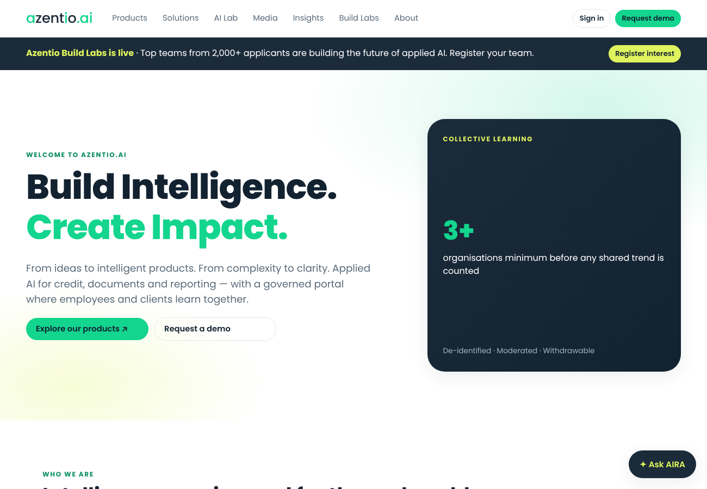

# azentio.ai — Website & Intelligent Collaboration Portal

Hackathon build for Azentio Build Labs, Problem Statement 7. Zero dependencies: Node 18+ only.

**Live demo:** https://azentio-ai.narrator-systems.workers.dev (Cloudflare Workers)
Demo password for every seeded account: `demo1234`. For example, use `priya@azentio.com` (employee), `lena@azentio.com` (moderator), `admin@azentio.com` (admin) or `sara@gulfhorizon.example` (client admin). All demo data is synthetic.



## Run locally
```
npm start                          # http://localhost:3000
ANTHROPIC_API_KEY=sk-ant-... npm start   # AIRA answers with Claude (otherwise extractive answers with citations)
```
Optional env: `PORT`, `MIN_COHORT` (default 3), `AIRA_MODEL` (default claude-sonnet-5-5).

## Demo accounts (password `demo1234`)
| Role | Email |
|---|---|
| Employee | priya@azentio.com |
| Product owner | omar@azentio.com |
| Learning moderator | lena@azentio.com |
| Content publisher | ravi@azentio.com |
| Portal administrator | admin@azentio.com |
| Client admin (Gulf Horizon) | sara@gulfhorizon.example |
| Client member (Gulf Horizon) | tom@gulfhorizon.example |
| Client member (Sahel) | amina@sahel.example |
| Client with 2 orgs (workspace switcher) | kenji@pacifictrade.example |
Invitation demo: open `/#/invite/demo-invite-gulf`.

## Host it
- **Fastest public URL:** `npm start` then `cloudflared tunnel --url http://localhost:3000` (Cloudflare Quick Tunnel).
- **Permanent:** push to GitHub and deploy as a Node web service on Render / Railway / Fly (start command `npm start`, set `ANTHROPIC_API_KEY`).
Data is in-memory synthetic seed; it resets on restart (production would use Postgres).

## How requirements are met
- **IAM-01/02:** every `/api` route checks role grant + active tenant membership (stored in the server session, never sent by the client) + resource audience + product entitlement. Public must be explicitly `public`; missing audience = deny. Employee needs `@azentio.com` AND an approved `employee` grant. Publish / moderate / invite / role-change are separate grants. Direct API and media requests are enforced (`/api/media/:id`).
- **Client portal:** org dashboard, entitlements with empty states, sandbox runs isolated per tenant/user, My vs Our organisation's observations, shared feed with filters (offering, industry, region, period, topic), CSV export using the same rules, client admin invites/revokes (client roles only, own org), workspace switcher.
- **Learning workflow:** explicit state machine draft → submitted → returned/published/rejected → withdrawn / under_review, audited. Saving = private draft. Shared copy is a separate record with only reviewed fields (no tenant ID, author, notes). Material edit → new version + re-review. Report → temporary unpublish. Withdrawal is synchronous: search, themes and AIRA read only active shared copies.
- **Consent:** separate store / publish / attribution / training permissions with history.
- **Aggregation:** distinct-organisation count, suppressed below `MIN_COHORT`; 3 synthetic orgs seeded for the "Seasonality context" scenario.
- **Ideas:** product owners link only approved evidence; statuses Proposed → Not proceeding, audited; contributors notified in-app.
- **AIRA:** retrieves only public catalogue + approved shared copies the user can see; cites sources; employee-only and private content never enters the prompt.
- **Employee portal:** dashboard, guided Playground (synthetic, labelled simulated), employee-only broadcasts, experiments, knowledge library with owners/review dates/feedback, release notes, hackathon team spaces.
- **Notifications:** persisted in-app; never labelled "email delivered" (email is P1).
- **P2 federated learning:** 3 isolated synthetic client datasets, local training, sample-weighted FedAvg, update validation + L2 clipping, dropout scenario, holdout vs baseline, candidate registry needing human approval, honest caveats (no secure aggregation / DP claimed, no "untraining").

Production propagation SLA for withdrawal: immediate in this build; target ≤ 60 s once caches/search indexes are added.

## azentio.com content
`public/azentio-content.json` holds 59 pages crawled from azentio.com (Banking, Insurance, Risk & Compliance, Capital Markets, ERP, Insights, Company). They render at `#/az/<path>` with a source link back to azentio.com, and AIRA can cite them (`[page:/path]`).

## Cloudflare Workers hosting

`worker.js` + `wrangler.toml` run the same app on Cloudflare Workers: static pages and photos are served from Workers static assets (`public/`), and `/api/*` runs the same handler as the Node server. Sessions are HMAC-signed cookies (set `SESSION_SECRET`).

    npx wrangler@4 deploy
    npx wrangler@4 secret put ANTHROPIC_API_KEY
    npx wrangler@4 secret put SESSION_SECRET

Demo data is held in memory per Worker instance, so changes made in the demo can reset when Cloudflare starts a new instance. That's fine for a demo; use D1/KV for durable state.
